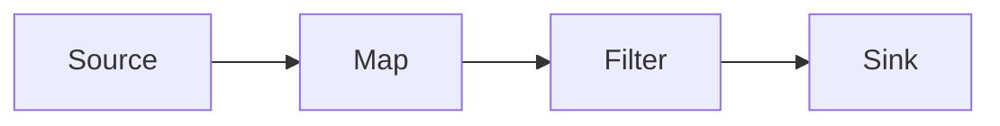
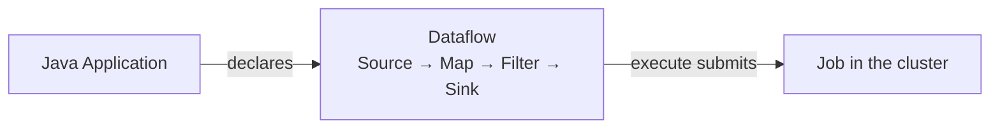
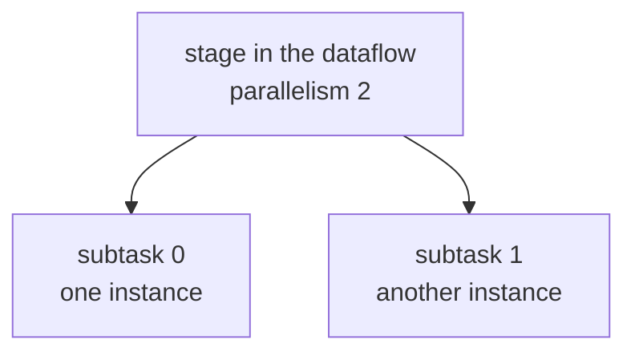

In the previous post, I prepared the project, dependencies, `main` class, and packaging. Now the API code has a place and a path to the cluster.

The first Job receives text, converts it to numbers, keeps only positive values, and prints the result:

```java
StreamExecutionEnvironment env =
    StreamExecutionEnvironment.getExecutionEnvironment();

env.fromData("10", "-2", "7")
    .name("Input Numbers")
    .map(Integer::parseInt)
    .name("Parse Integer")
    .filter(value -> value > 0)
    .name("Only Positive")
    .print()
    .name("Console Output");

env.execute("day03-first-dataflow");
```

## The dataflow

The code above describes this flow:



- **Source** introduces records into the stream (in this lab, it is a finite collection in memory).
- **map** converts each text value to an integer, and **filter** decides which values remain. These calls declare **transformations**.
- **print** plays the role of **Sink**, sending the result to the workers' output.

## Application and Job

The Java class is the Flink Application. It can contain configuration, build dataflows, and even originate more than one Job.

When `execute()` submits the computation, the runtime starts treating it as a Job.

```text
Application → declares
Job         → submitted/executed unit
```

That is why these two names should not be used as synonyms.

## Declare first, execute later

The chain of methods can create the impression that `map` already receives the values at that moment. But while the Java Application is running, it is still only building the description of the work: which stages exist and how they connect.

There are two different moments:

- the Java Application declares the dataflow;
- `execute()` sends that description to the cluster to run as a Job.



Only after submission do values start flowing through the stages. This separation allows Flink to validate and prepare a plan before distributed execution.

## Transformation and operator

These two names may seem farther apart than they really are. They describe the same stage of the flow, but from different points of view.

When I write this part:

```java
.map(Integer::parseInt)
    .name("Parse Integer")
```

I am declaring a **transformation**: converting text such as `"10"` into the number `10`. When Flink builds the Job description, that stage appears as an **operator** called `Parse Integer`.

| In the code | What the stage does | In the Job |
| --- | --- | --- |
| `.map(Integer::parseInt)` | Converts text to numbers | operator `Parse Integer` |
| `.filter(value -> value > 0)` | Keeps only positive numbers | operator `Only Positive` |

At this point, I do not need to memorize a rigid technical boundary between the terms:

- **transformation** helps describe the stage I declare in the code;
- **operator** helps describe that same stage inside the dataflow and in the Web UI.

This still does not create a process or machine for each operator. We are still talking about the logical structure of the Job.

## Parallelism and subtasks

A logical stage in the dataflow can have multiple copies working in parallel:



The **parallelism** tells how many parallel instances an operator will have. When a stage has parallelism 2, it has two subtasks: `subtask 0` and `subtask 1`. Each subtask is a concrete instance of the operator representing that stage.

This is still a logical division. Parallelism 2 does not mean two machines or two exclusive cores; it does not define where these subtasks will run.

For now, it is enough to name this structure. How records are distributed across subtasks is the next step.

## What I observed

To test the first Job, I used the three values defined in the Source: `"10"`, `"-2"`, and `"7"`. After the `map`, they became the numbers `10`, `-2`, and `7`.

Then I compared two rules in the `filter`:

| Rule | Values that remain |
| --- | --- |
| `value -> value > 0` | `10` and `7` |
| `value -> value > 7` | `10` |

The Job ends shortly after processing these values because this Source is finite. That is expected; it is not failing and it is not waiting for new data. The output of `print` appears in the TaskManager logs, not necessarily in the terminal where the commands were executed.

In both executions, the path remains the same: the Source delivers the values, the `map` converts them to numbers, the `filter` decides what continues, and the `print` shows the result. The only change was the rule used by the `filter`:

- before: “is the number greater than zero?”;
- after: “is the number greater than seven?”.

That is why the result changed without needing to build a new dataflow. I only changed a rule inside an existing stage.

## The idea I want to keep

An Application registers transformations that form a dataflow. `execute()` submits that description as a Job. Operators can be expanded into subtasks according to parallelism without determining how many machines exist.

In the next post, I will figure out how an event chooses its subtask and why `keyBy` can trigger a shuffle.

_References: [DataStream operators](https://nightlies.apache.org/flink/flink-docs-release-2.2/docs/dev/datastream/operators/overview/) and [parallel execution](https://nightlies.apache.org/flink/flink-docs-release-2.2/docs/dev/datastream/execution/parallel/)._
