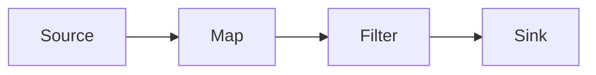
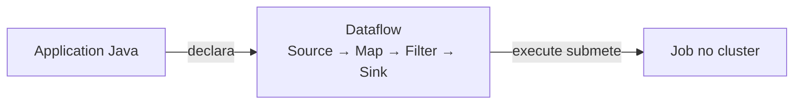
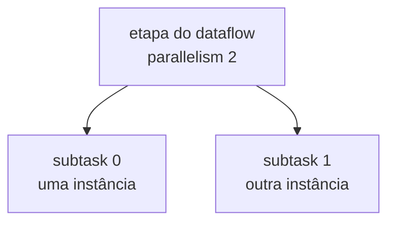

No post anterior, preparei projeto, dependências, classe `main` e empacotamento. Agora o código da API tem um lugar e um caminho até o cluster.

O primeiro Job recebe textos, converte para números, mantém valores positivos e imprime o resultado:

```java
StreamExecutionEnvironment env =
    StreamExecutionEnvironment.getExecutionEnvironment();

env.fromData("10", "-2", "7")
    .name("Input Numbers")
    .map(Integer::parseInt)
    .name("Parse Integer")
    .filter(value -> value > 0)
    .name("Only Positive")
    .print()
    .name("Console Output");

env.execute("day03-first-dataflow");
```

## O dataflow

O código acima descreve este caminho:



- **Source** introduz os registros no fluxo (neste laboratório, é uma coleção finita em memória).
- **map** converte cada texto para inteiro e **filter** decide quais valores permanecem. Essas chamadas declaram **transformations**.
- **print** ocupa o papel de **Sink**, enviando o resultado para a saída dos workers.

## Application e Job

A classe Java é a Flink Application. Ela pode conter configuração, construir dataflows e até originar mais de um Job.

Quando `execute()` submete a computação, o runtime passa a tratá-la como um Job.

```text
Application → declara
Job         → unidade submetida/executada
```

Por isso os dois nomes não deveriam ser usados como sinônimos.

## Declarar primeiro, executar depois

A cadeia de métodos pode dar a impressão de que `map` já recebe os valores naquele momento. Mas, enquanto a Application Java está rodando, ela ainda está apenas montando a descrição do trabalho: quais etapas existem e como elas se conectam.

Existem dois momentos diferentes:

- a Application Java declara o dataflow;
- `execute()` envia essa descrição para o cluster executar como um Job.



Só depois da submissão os valores começam a percorrer as etapas. Essa separação permite que o Flink valide e prepare um plano antes da execução distribuída.

## Transformation e operator

Esses dois nomes parecem mais distantes do que realmente são. Eles descrevem a mesma etapa do fluxo, mas vistos de pontos diferentes.

Quando escrevo este trecho:

```java
.map(Integer::parseInt)
    .name("Parse Integer")
```

estou declarando uma **transformation**: converter um texto, como `"10"`, no número `10`. Quando o Flink monta a descrição do Job, essa etapa aparece como um **operator** chamado `Parse Integer`.

| No código | O que a etapa faz | No Job |
| --- | --- | --- |
| `.map(Integer::parseInt)` | Converte texto em número | operator `Parse Integer` |
| `.filter(value -> value > 0)` | Mantém apenas números positivos | operator `Only Positive` |

Para este momento, não preciso decorar uma fronteira técnica rígida entre os termos:

- **transformation** ajuda a falar da etapa que declaro no código;
- **operator** ajuda a falar dessa mesma etapa dentro do dataflow e na Web UI.

Isso ainda não cria um processo ou uma máquina para cada operator. Continuamos falando apenas da estrutura lógica do Job.

## Parallelism e subtasks

Uma etapa lógica do dataflow pode ter várias cópias trabalhando em paralelo:



O **parallelism** informa quantas instâncias paralelas uma etapa terá. Quando uma etapa tem parallelism 2, ela possui duas subtasks: `subtask 0` e `subtask 1`. Cada subtask é uma instância concreta do operator que representa essa etapa.

Essa ainda é uma divisão lógica. Parallelism 2 não significa duas máquinas nem dois cores exclusivos; ele não define em quais processos essas subtasks vão rodar.

Por enquanto, basta nomear essa estrutura. A distribuição dos registros entre as subtasks é o próximo passo.

## O que observei

Para conferir o primeiro Job, usei os três valores definidos na Source: `"10"`, `"-2"` e `"7"`. Depois do `map`, eles viram os números `10`, `-2` e `7`.

Em seguida, comparei duas regras no `filter`:

| Regra | Valores que permanecem |
| --- | --- |
| `value -> value > 0` | `10` e `7` |
| `value -> value > 7` | `10` |

O Job termina logo depois de processar esses valores porque essa Source é finita. Isso é esperado, ele não está falhando nem esperando novos dados. A saída do `print` aparece nos logs do TaskManager, não necessariamente no terminal em que os comandos foram executados.

Nas duas execuções, o caminho continua igual: a Source entrega os valores, o `map` os converte em números, o `filter` decide quais continuam e o `print` mostra o resultado. A única mudança foi a pergunta feita pelo `filter`:

- antes: “o número é maior que zero?”;
- depois: “o número é maior que sete?”.

Por isso o resultado mudou sem que eu precisasse montar um novo dataflow. Troquei uma regra dentro de uma etapa que já existia.

## A ideia que quero guardar

Uma Application registra transformations que formam um dataflow. `execute()` submete essa descrição como Job. Operators podem ser expandidos em subtasks conforme o parallelism, sem que isso determine quantas máquinas existem.

No próximo post, vou descobrir como um evento escolhe sua subtask e por que `keyBy` pode provocar um shuffle.

_Referências: [DataStream operators](https://nightlies.apache.org/flink/flink-docs-release-2.2/docs/dev/datastream/operators/overview/) e [execução paralela](https://nightlies.apache.org/flink/flink-docs-release-2.2/docs/dev/datastream/execution/parallel/)._
